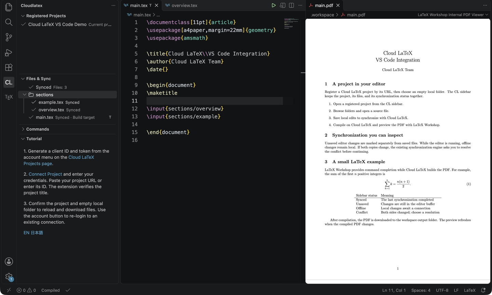
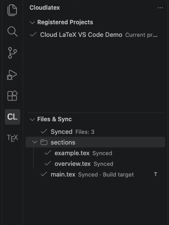
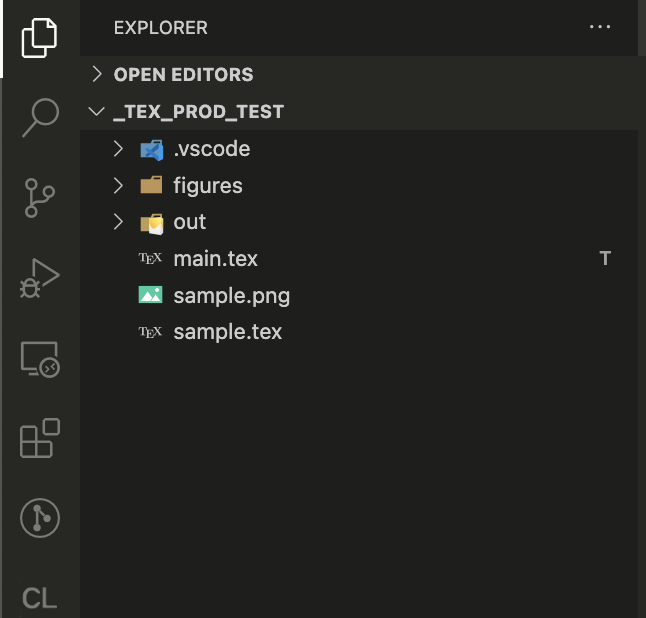
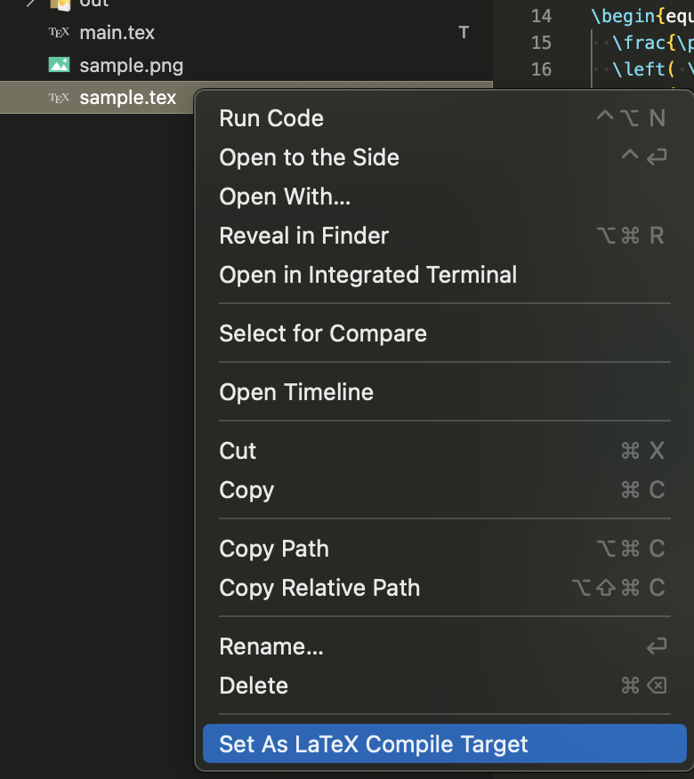

# Cloud LaTeX Extension for Visual Studio Code


[](https://opensource.org/licenses/Apache-2.0)

\*\*\* Write locally and compile on cloud service.

This is an extension for Visual Studio Code to write tex locally with Cloud LaTeX.

[日本語](https://github.com/cloudlatex-team/cloudlatex-vscode-extension/blob/main/docs/README_ja.md)

# Features

- Tex files you edit with VSCode can be compiled without installing texlive on your PC
- [Cloud LaTeX](https://cloudlatex.io/) official plugin
- Automatic synchronization between files in your PC and the Cloud LaTeX server
- Offline support (auto-sync on return to online)

Edit locally, compile on Cloud LaTeX, and view the PDF alongside your source with LaTeX Workshop.



# Installation

Install from [VSCode Marketplace](https://marketplace.visualstudio.com/items?itemName=cloudlatex.cloudlatex), or run `ext install cloudlatex` in VS Code Quick Open (`ctrl/cmd + P`).

# Preparation

1. If you do not have a Cloud LaTeX account, create one at [Cloud LaTeX](https://cloudlatex.io/).
2. From the account menu on the [Projects page](https://cloudlatex.io/projects), open **Extension** and generate a client ID and token. Token generation still takes place on the website.
3. Create a project on the website if you do not already have one.

## Setting

### Connect from the sidebar

1. Click the **CL** icon in the Activity Bar, then **Connect Project**.
2. Open a separate empty local folder for the project. If no folder is open, the command opens a folder picker; after opening the folder, click **Connect Project** again.
3. Enter your email address, client ID, and token. If saved credentials are valid, the command skips this step.
4. Paste the URL of the Cloud LaTeX project open in your browser or enter its numeric ID. The extension verifies the project title before continuing.
5. Check the project and local folder, then choose **Connect and Reload**. The extension saves the connection settings, reloads VS Code, and downloads the project files.

You can also run **Cloud LaTeX: Connect Project** from the Command Palette (`Cmd+Shift+P` on macOS, `Ctrl+Shift+P` on Windows/Linux).
To find a project URL, open the project from the [Cloud LaTeX Projects page](https://cloudlatex.io/projects) and copy the address from your browser.

The first connection requires a single local folder with no project files. The `.vscode` directory, `.git` metadata, and `.DS_Store` can be present. Canceling before confirmation leaves your account and connection settings unchanged.

To update credentials for an existing connection, use the sidebar's account button. To connect another project, open a separate empty folder and use **Connect Project** there. The command does not switch an enabled connection or adopt existing local source files.

If the download does not start after reloading, check the account and network connection, then use **Reload** in the Cloud LaTeX sidebar.

### Projects, files, and synchronization

The **CL** sidebar has three main views:

- **Registered Projects** keeps your project shortcuts across workspaces in the current VS Code profile. Use the **+** button or **Register Project by URL / ID** to enter a Cloud LaTeX project URL or ID. The extension verifies the project title before adding the shortcut. Connected projects are also remembered automatically.
- **Files & Sync** shows the current project's tracked files in folders. Click a file to open its local copy. The tree marks the build target, unsaved edits, local or server changes, and conflicts. The summary shows synchronization progress or its last outcome; hover over it to see the last successful sync time.
- **Commands** contains connection, account, settings, synchronization, compilation, and PDF actions.



The registered list is a set of verified shortcuts, not a copy of every project in your web account. The shortcuts do not contain tokens or client IDs. Registering a shortcut does not download or synchronize its files.

Clicking a project with a known local folder opens that folder. For an unconnected project, clicking it opens a folder picker. Select an empty local folder to connect and download automatically. Your automatic compilation preference, output directory, and ignored-file settings are carried over; you do not need to select the project again. Existing connected folders and folders inside the current project cannot be reused. **Remove Project from List** only removes the shortcut; it does not delete local or server files or disable an existing connection.

**Unsaved** means an editor buffer has not been saved to disk, so those edits have not been synchronized. Local/server change labels describe the synchronization metadata from the latest checks; they are not a continuous view of remote edits. Save the file to let normal synchronization process it, or use **Reload** to request a sync. A conflict needs resolution before synchronization can finish.

To synchronize and browse without automatic compilation, set `cloudlatex.autoCompile` to `false` before connecting. This also prevents an automatic compile after the initial download. The **Compile** command remains available for a manual build.

### Manual project settings (optional)

For an account that is already configured, you can still enter the project ID and enable the extension through **Project Setting** or the workspace's `.vscode/settings.json`. Use **Workspace** settings rather than **User** settings. The project ID is the number in the website URL, for example `/projects/123/edit` means `123`.

```json
{
  "cloudlatex.projectId": 123,
  "cloudlatex.enabled": true,
  "cloudlatex.outDir": "./.workspace"
}
```

After changing Cloud LaTeX settings manually, reload the VS Code window when prompted. Use a separate empty folder for each project. While synchronization is enabled, deleting local project files also deletes the corresponding server files.

### LaTeX Workshop integration

With [LaTeX Workshop](https://marketplace.visualstudio.com/items?itemName=James-Yu.latex-workshop), you can preview PDFs and use command completion.
Run **Cloud LaTeX: Configure LaTeX Workshop** from the Command Palette, or click **Configure LaTeX Workshop** in the Cloud LaTeX sidebar. Review the proposed settings, then apply them to the current workspace.

The command disables LaTeX Workshop's local automatic builds and points its viewer to the Cloud LaTeX output directory. It only updates these two workspace settings. Cloud LaTeX settings, user settings, and formatting preferences stay as they are. Configuring the integration does not contact the Cloud LaTeX server.

For example, when `cloudlatex.outDir` is `./.workspace`, the settings are:

```json
{
  "latex-workshop.latex.autoBuild.run": "never",
  "latex-workshop.latex.outDir": "%WORKSPACE_FOLDER%/.workspace"
}
```

The workspace placeholder keeps the viewer's output path correct even when the main `.tex` file is in a subfolder. An empty `cloudlatex.outDir` uses `%WORKSPACE_FOLDER%`; an absolute output path is kept as an absolute path. Rerun the command after changing `cloudlatex.outDir`.

**View PDF** opens the downloaded PDF for the current compile target and remains available if the connection goes offline during the session. If LaTeX Workshop is not installed, you can choose **Open LaTeX Workshop in Marketplace** or **Open PDF Externally** to use the system PDF viewer. If the PDF has not been downloaded yet, compile the project first.

### Settings reference

| Setting key               | Description                                                                       | Default              | Type              |
| ------------------------- | --------------------------------------------------------------------------------- | -------------------- | ----------------- |
| `cloudlatex.enabled`      | Set true to enable cloudlatex plugin in this project                              | `false`              | _boolean_         |
| `cloudlatex.projectId`    | ProjectId. \*Do not mistake this value, otherwise your files might be overwritten | `0`                  | _number_          |
| `cloudlatex.outDir`       | Directory to output compile result                                                | `""`                 | _string_          |
| `cloudlatex.autoCompile`  | Set true to automatically compile when any files are saved                        | `true`               | _boolean_         |
| `cloudlatex.supressIcon`  | Set true to hide cloudlatex icon on the activity bar in the unactivated project   | `false`              | _boolean_         |
| `cloudlatex.ignoredFiles` | Files to be ignored from file synchronization                                     | See the next section | _Array\<string\>_ |

### Specifying files not to be synchronized

Files matching the glob pattern specified in `cloudlatex.ignoredFiles` are ignored from the file synchronization process. The glob patterns are matched against the absolute file pattern.
Patterns are compatible with [anymatch](https://github.com/micromatch/anymatch).

Examples

- Do not synchoronize files named 'README.md' : `**/README.md`
- Do not synchoronize files with 'bin' extension: `**/*.bin`
- Do not synchoronize files under 'test' directory: `**/test/**`

By default, file names starting with `.` except for `.latexmkrc` and extensions related to LaTeX compiled artifacts are set.  
For performance reasons, `.git` and `node_modules` are also ignored from the file synchronization process, regardless of `cloudlatex.ignoredFiles`.

<details>
<summary>Default value of cloudlatex.ignoredFiles </summary>

```
[
  "**/*.aux",
  "**/*.bbl",
  "**/*.bcf",
  "**/*.blg",
  "**/*.idx",
  "**/*.ind",
  "**/*.lof",
  "**/*.lot",
  "**/*.out",
  "**/*.toc",
  "**/*.acn",
  "**/*.acr",
  "**/*.alg",
  "**/*.glg",
  "**/*.glo",
  "**/*.gls",
  "**/*.ist",
  "**/*.fls",
  "**/*.log",
  "**/*.nav",
  "**/*.snm",
  "**/*.fdb_latexmk",
  "**/*.synctex.gz",
  "**/*.synctex\\(busy\\)",
  "**/*.synctex.gz\\(busy\\)",
  "**/*.run.xml",
  "**/.vscode/**",
  "**/.!(latexmkrc)"
]
```

</details>

## Change compile target

Current compile target is shown as `T` in the explorer.



Compile target can be changed from `Set As LaTeX Compile Target` in the context menu.



# Source Code

https://github.com/cloudlatex-team/cloudlatex-vscode-extension/tree/main

# License

Apache License 2.0

# Development

See [development](docs/development.md)
