# Cloud LaTeX Extension for Visual Studio Code


[](https://opensource.org/licenses/Apache-2.0)

# 特徴

- ローカル PC に texlive をインストールすることなく VSCode で編集した tex ファイルをコンパイル可能に
- [Cloud LaTeX](https://cloudlatex.io/)公式 VSCode プラグイン
- ローカル上のファイルと Cloud LaTeX サーバ上のファイルを自動同期
- オフライン時のファイル編集にも対応 (オンライン復帰時に自動同期)

ローカルで編集し、Cloud LaTeX でコンパイルした PDF を LaTeX Workshop で原稿の横に表示できます。

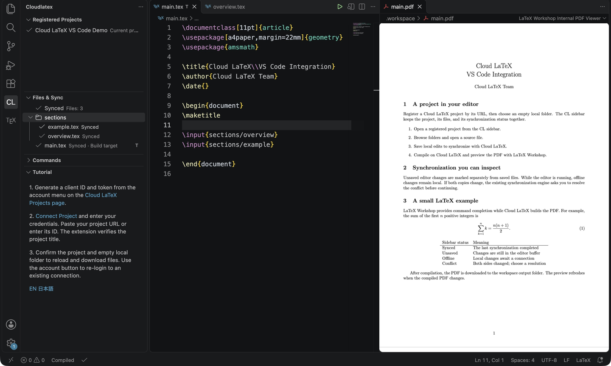

# インストール

[Visual Studio Marketplace](https://marketplace.visualstudio.com/items?itemName=cloudlatex.cloudlatex)からインストール、あるいはクイックオープン(`ctrl/cmd + P`)に `ext install cloudlatex` と入力します.

# 準備

1. Cloud LaTeX のアカウントを持っていない場合は、[Cloud LaTeX](https://cloudlatex.io/) から作成します。
2. [プロジェクト一覧](https://cloudlatex.io/projects) の右上のユーザ名をクリックし、プラグイン連携からクライアント ID とトークンを発行します。トークンの発行は従来どおり Web サイトで行います。

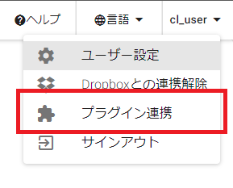
<br />
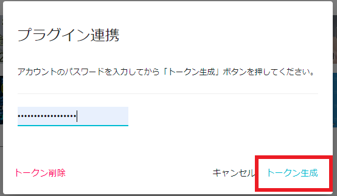

3. 接続するプロジェクトがまだない場合は、Web サイトで作成します。

# サイドバーから接続する

1. Activity Bar の **CL** アイコンをクリックし、**プロジェクトを接続** を選びます。
2. プロジェクト専用の空のローカルフォルダを開きます。フォルダを開いていない場合は選択画面が表示されるので、フォルダを開いてからもう一度 **プロジェクトを接続** を選んでください。
3. メールアドレス、クライアント ID、トークンを入力します。保存済みの認証情報が有効なら、この入力は省略されます。
4. ブラウザで開いている Cloud LaTeX のプロジェクトの URL または数値の ID を入力します。拡張機能がプロジェクトのタイトルを確認してから次へ進みます。
5. プロジェクト名とローカルフォルダを確認し、**接続して再読み込み** を選びます。接続設定を保存して VS Code を再読み込みし、プロジェクトのファイルをダウンロードします。

コマンドパレット（macOS: `Cmd+Shift+P`、Windows/Linux: `Ctrl+Shift+P`）の **Cloud LaTeX: プロジェクトを接続** からも利用できます。
プロジェクトの URL は、[Cloud LaTeX のプロジェクト一覧](https://cloudlatex.io/projects) から対象を開き、ブラウザのアドレス欄からコピーしてください。

最初の接続では、プロジェクトのファイルが入っていないローカルフォルダを一つだけ開いてください。`.vscode` ディレクトリ、`.git` の管理情報、`.DS_Store` はあっても構いません。確認画面までにキャンセルした場合は、アカウント情報や接続設定を変更しません。

接続済みプロジェクトに再ログインする場合は、サイドバーのアカウントボタンを使います。別のプロジェクトには、別の空フォルダを開いて **プロジェクトを接続** から接続してください。連携が有効なフォルダの接続先を切り替えたり、既存のローカル原稿を取り込んだりする操作には対応していません。

再読み込み後もダウンロードが始まらない場合は、認証情報や通信状態を確認してからサイドバーの **リロード** を実行してください。
VS Code を日本語表示にすると、拡張機能の表示も日本語になります。（[UI 言語設定](#ui-言語設定)）

## プロジェクト・ファイル・同期状態の表示

**CL** サイドバーには、次の三つの主要ビューがあります。

- **登録済みプロジェクト** は、この端末内で、ワークスペースや VS Code プロファイルをまたいで使えるプロジェクトのショートカット一覧です。**+** ボタンまたは **URL／IDでプロジェクトを登録** から、Cloud LaTeX のプロジェクト URL または ID を入力します。タイトルを確認してショートカットを追加します。接続したプロジェクトも自動で記録されます。
- **ファイル・同期状態** は、現在のプロジェクトで追跡しているファイルをフォルダ階層で表示します。ファイルをクリックするとローカルのファイルを開きます。コンパイル対象、未保存の編集、ローカルやサーバの変更、競合を表示します。先頭の行には同期の進行状況または直近の結果を表示し、マウスを重ねると最終同期時刻を確認できます。
- **Commands** には、接続、アカウント、設定、同期、コンパイル、PDF 表示の操作があります。

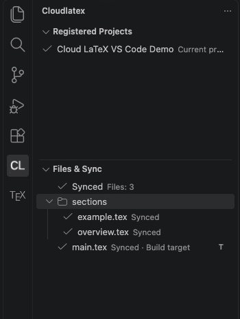

登録済みプロジェクトは、確認済みのショートカット一覧です。Web アカウントにある全プロジェクトを取得した一覧ではありません。一覧はこの端末に保存され、VS Code のウィンドウとプロファイル間で共有されます。ショートカットにトークンやクライアント ID は含みません。ショートカットを登録するだけではファイルのダウンロードや同期は行いません。

ローカルフォルダが記録されているプロジェクトをクリックすると、そのフォルダを開きます。ローカル未接続の場合は、クリックすると保存先フォルダの選択画面が開きます。空のローカルフォルダを選ぶと、そのプロジェクトに接続してファイルを自動取得します。自動コンパイルの設定、出力先、除外ファイル設定も引き継ぐため、プロジェクトを選び直す必要はありません。接続済みフォルダや、現在のプロジェクト内のフォルダは保存先にできません。**一覧から登録を解除** はショートカットだけを削除します。ローカルやサーバのファイルを削除したり、既存の接続を無効にしたりする操作ではありません。

出力先は、プロジェクト内を指す相対パスだけを引き継ぎます。絶対パスやプロジェクトの外を指すパスの場合、新しいフォルダでは既定の出力先を使用します。

**未保存** は、エディタ上の編集がまだディスクに保存されておらず、その内容が同期されていないことを示します。ローカル・サーバの変更表示は、直近の確認で得られた同期情報です。サーバ側の編集を常時監視した表示ではありません。ファイルを保存すると通常の同期処理が働き、**リロード** からも同期を要求できます。競合がある場合は、解決してから同期を完了します。

自動コンパイルせずに同期やファイル閲覧を行いたい場合は、接続前に `cloudlatex.autoCompile` を `false` に設定してください。最初のダウンロード後にも自動コンパイルを実行しません。**コンパイル** から手動でビルドできます。

## 手動でプロジェクトを設定する場合

アカウントが設定済みの場合は、従来どおり **プロジェクト設定** またはワークスペースの `.vscode/settings.json` からプロジェクト ID と連携の有効化を設定できます。**User** ではなく **Workspace** に設定してください。プロジェクト ID は Web サイトの URL に含まれる数値です。例えば `/projects/123/edit` なら `123` です。

```json
{
  "cloudlatex.projectId": 123,
  "cloudlatex.enabled": true,
  "cloudlatex.outDir": "./.workspace"
}
```

Cloud LaTeX の設定を手動で変更した後は、表示される案内から VS Code のウィンドウを再読み込みしてください。プロジェクトごとに別の空フォルダを使用してください。同期が有効な状態でローカルのプロジェクトファイルを削除すると、サーバ上の対応するファイルも削除されます。

## LaTeX Workshop との連携

[LaTeX Workshop](https://marketplace.visualstudio.com/items?itemName=James-Yu.latex-workshop) と併用すると、PDF のプレビューやコマンド補完が使えます。
コマンドパレットから **Cloud LaTeX: LaTeX Workshop 連携を設定** を実行するか、Cloud LaTeX のサイドバーで **LaTeX Workshop 連携を設定** を選びます。表示される設定内容を確認してから、現在のワークスペースに適用してください。

このコマンドは、LaTeX Workshop によるローカルの自動ビルドを無効にし、PDF の参照先を Cloud LaTeX の成果物出力先に合わせます。変更するのは次の二つのワークスペース設定だけです。Cloud LaTeX 自体の設定、ユーザ設定、フォーマット設定は変更しません。連携の設定時に Cloud LaTeX サーバへの接続は行いません。

例えば `cloudlatex.outDir` が `./.workspace` の場合、以下のように設定されます。

```json
{
  "latex-workshop.latex.autoBuild.run": "never",
  "latex-workshop.latex.outDir": "%WORKSPACE_FOLDER%/.workspace"
}
```

ワークスペースを基準にするため、メインの `.tex` ファイルがサブフォルダにあっても成果物を正しく参照できます。`cloudlatex.outDir` が空の場合は `%WORKSPACE_FOLDER%`、絶対パスの場合はその絶対パスを使用します。`cloudlatex.outDir` を変更した後は、このコマンドを再実行してください。

**PDF 表示** は、現在のコンパイルターゲットのダウンロード済み PDF を開きます。接続済みのプロジェクトで通信がオフラインになった場合も利用できます。LaTeX Workshop が未インストールの場合は、インストールするか、外部アプリで開くかを選べます。PDF がまだダウンロードされていない場合は、先にプロジェクトをコンパイルしてください。

## 設定項目一覧

| Setting key               | Description                                                                                                                       | Default  | Type              |
| ------------------------- | --------------------------------------------------------------------------------------------------------------------------------- | -------- | ----------------- |
| `cloudlatex.enabled`      | プラグインを有効にするかどうか                                                                                                    | `false`  | _boolean_         |
| `cloudlatex.projectId`    | プロジェクト ID. \*設定を間違えるとローカルファイルが別のプロジェクトファイルの内容に上書きされる可能性があるので注意してください | `0`      | _number_          |
| `cloudlatex.outDir`       | コンパイル成果物出力先ディレクトリ                                                                                                | `""`     | _string_          |
| `cloudlatex.autoCompile`  | 自動コンパイルを有効にするかどうか                                                                                                | `true`   | _boolean_         |
| `cloudlatex.supressIcon`  | `true` にすると LaTeX プロジェクト以外のプロジェクトでは Activity Bar に CL アイコンが表示されなくなります                        | `false`  | _boolean_         |
| `cloudlatex.ignoredFiles` | 同期を行わないファイルを指定                                                                                                      | 次項参照 | _Array\<string\>_ |

### 同期を行わないファイルの指定

`cloudlatex.ignoredFiles` で指定された glob パターンにマッチしたファイルはファイル同期処理から無視されます。 **絶対ファイルパス** に対してパターンのマッチング処理が行われます。
指定できるパターンは [anymatch](https://github.com/micromatch/anymatch)と互換性があります。

例

- 'README.md' ファイルを同期させない: `**/README.md`
- 'bin' 拡張子を持つファイルを同期させない: `**/*.bin`
- 'test' ディレクトリ以下を同期させない: `**/test/**`

デフォルトでは `.latexmkrc` を除く `.`から始まるファイル名と LaTeX のコンパイル成果物に関係する拡張子が指定されています。
またパフォーマンス上の理由から `cloudlatex.ignoredFiles` の設定値によらず、`.git`, `node_modules`は常に同期されません。

<details>
<summary>cloudlatex.ignoredFiles のデフォルト値 </summary>

```
[
  "**/*.aux",
  "**/*.bbl",
  "**/*.bcf",
  "**/*.blg",
  "**/*.idx",
  "**/*.ind",
  "**/*.lof",
  "**/*.lot",
  "**/*.out",
  "**/*.toc",
  "**/*.acn",
  "**/*.acr",
  "**/*.alg",
  "**/*.glg",
  "**/*.glo",
  "**/*.gls",
  "**/*.ist",
  "**/*.fls",
  "**/*.log",
  "**/*.nav",
  "**/*.snm",
  "**/*.fdb_latexmk",
  "**/*.synctex.gz",
  "**/*.synctex\\(busy\\)",
  "**/*.synctex.gz\\(busy\\)",
  "**/*.run.xml",
  "**/.vscode/**",
  "**/.!(latexmkrc)"
]
```

</details>

## UI 言語設定

VSCode の言語設定で日本語が設定されている場合は当拡張機能の UI も日本語表示になります。
日本語表示にするには[こちら](https://marketplace.visualstudio.com/items?itemName=MS-CEINTL.vscode-language-pack-ja) から Japanese Language Pack をインストールしてください

# ファイルの同期とコンパイル

- オンラインの際にはローカルで行ったでファイルの変更が自動で同期されます。
  Cloud LaTeX の web アプリから行ったファイルの変更もローカルに反映されます。

`Project setting` で `cloudlatex.autoCompile` にチェックを入れることで、ファイル保存時に自動でコンパイルが行われます。
CL アイコンをクリックすることで表示されるサイドパネルの、 `Compile` ボタンからコンパイルすることも可能です。
コンパイル完了後、`Project setting` の `cloudlatex.outDir` に設定したディレクトリ以下に pdf がダウンロードされます。

## コンパイラ出力の確認

- tex ファイルに構文エラーがあり、コンパイルに失敗した場合、コンパイルに失敗した旨のダイアログが表示されます。

  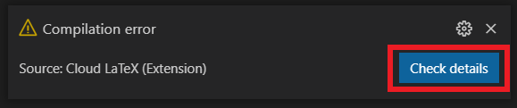

- `Check details` ボタンを押して、コンパイラ出力を確認してください。

  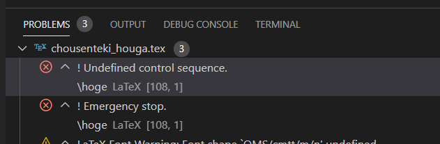

## ファイルのコンフリクト

- 同一のファイルをローカルとサーバ(Cloudlatex Web エディタ、あるいは Dropbox 連携機能)の両方で編集すると、ファイルのコンフリクトが発生します。コンフリクトが発生すると、ローカルかサーバ、いずれかの変更に合わせる必要があります。

- コンフリクトを検知すると、以下のダイアログが表示されます。

  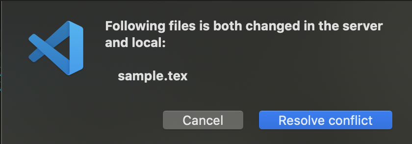

- `Resolve conflict` ボタンを押し、`Pull` か `Push` を選択します。

  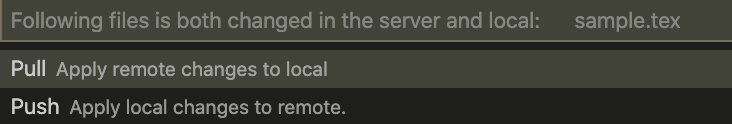

  - Pull: サーバの変更をダウンロードし、サーバに合わせます
  - Push: サーバにローカルの変更をアップロードすることで、ローカルに合わせます

  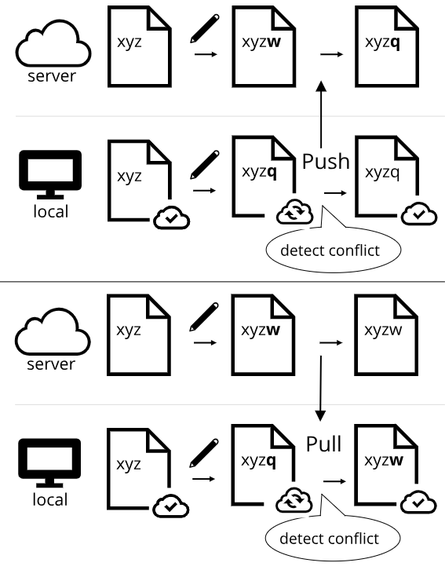

## コンパイルターゲットの変更

現在のコンパイルターゲットはファイルエクスプローラ上の `T` マークで確認できます

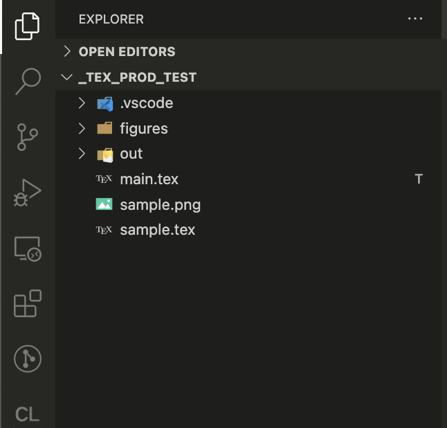

コンパイルターゲットはコンテキストメニューの `コンパイルターゲットに設定` より変更できます

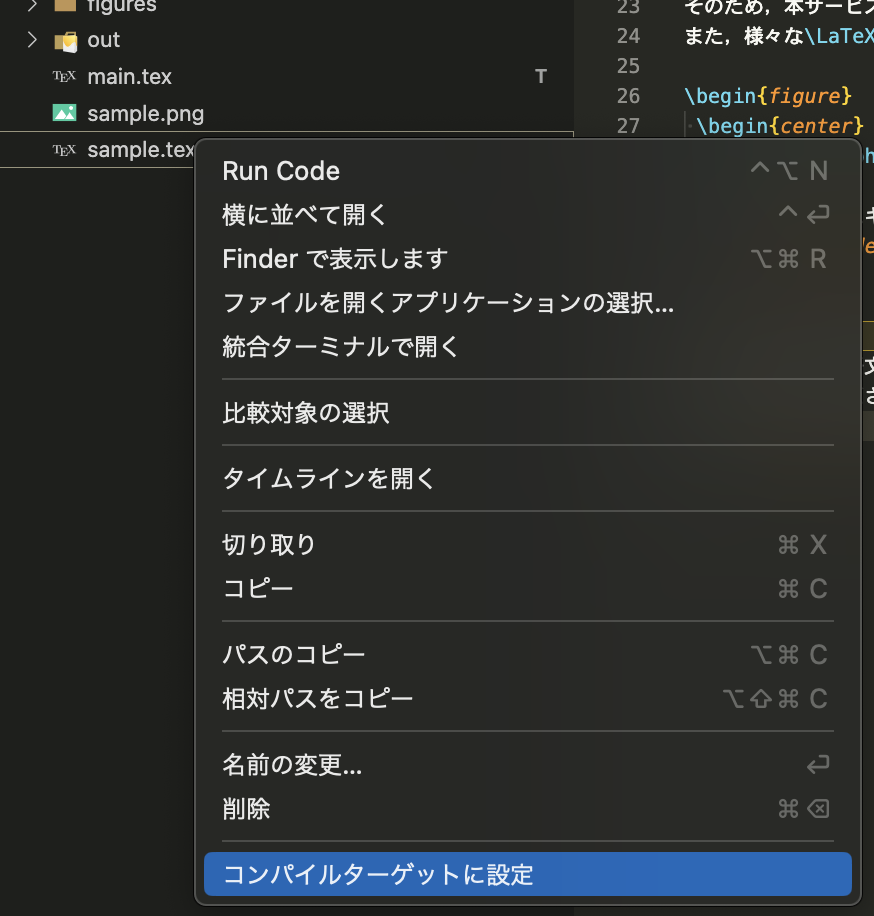

# トラブルシューティング

## 「`error in syncSession: ...`」 というエラーメッセージが表示され、ファイルの同期が完了しない

リモートサーバとのファイルの同期が失敗しています。
Cloud LaTeX web アプリのプロジェクトにアクセスし、コンパイルターゲットが設定されていない等の問題がないか確認してください。
また、ローカルに不正なファイル（.から始まるファイル、LaTeX で利用されない拡張子を持つファイル等）が存在しないか確認し、存在する場合は削除してください。
問題が解決しない場合、コマンドパレット(mac: `Cmd+Shift+P`, win: `Ctrl+Shift+P`)を開き、`cloud LaTeX: Reset local` コマンドを実行し、強制的にローカルファイルの状態をサーバの状態に合わせることが可能です (注: サーバに同期されていないローカルファイルの変更点は失われます)。

## コンパイル時に「`Target file is not found`」というエラーメッセージが表示される

コンパイルターゲットに指定したファイル名を変更または削除すると、コンパイルができなくなります。その場合、Cloud LaTeX web アプリよりコンパイルターゲットを設定しなおしてください。

## 起動時に「Be sure to set cloudlatex.enabled to true ...」というエラーメッセージが表示される

`Project setting`の `User` タブの `cloudlatex.autoCompile` のチェックを外してください。(`Project` タブの`cloudlatex.autoCompile` にのみチェックを入れる必要があります)

## 今までファイル同期できていたのにかかわらず、突然「Your account is invalid」という警告メッセージが表示され、同期ができなくなる

トークンの有効期限が切れた可能性があります。サイトにアクセスし、初回と同様の手順でトークンを発行しなおしてください。

## 「ディレクトリにファイルが存在します。ファイルの上書きを防ぐため、同期を行うディレクトリは空である必要があります。」または「The directory contains files. To prevent overwriting files, the directory to be synchronized must be empty.」というメッセージが表示されてファイルの同期が開始されない

同期を開始するディレクトリに既存のファイルがある場合、意図しない上書きの防止の為に同期が開始されません。
[サイドバーから接続する](#サイドバーから接続する)の通り、空のディレクトリで VSCode を開いてください。

# 注意事項

- VSCode でプロジェクトを開いている時にのみファイルの同期が行われます。そのため、プロジェクトを開いていない際に行ったファイル操作は同期されません。

# ソースコード

https://github.com/cloudlatex-team/cloudlatex-vscode-extension/tree/main

# ライセンス

Apache License 2.0

# 開発方法

[development](development.md) 参照
