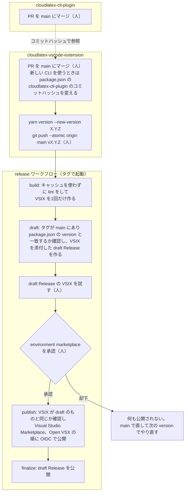

# リリース

## 全体の流れ

「（人）」が付いた作業は人が行う。それ以外は GitHub Actions が行う。



CLI は version やタグを付けてリリースしない。拡張機能の `package.json` が、`cloudlatex-cli-plugin` をコミットハッシュで参照する。

```json
"cloudlatex-cli-plugin": "https://github.com/cloudlatex-team/cloudlatex-cli-plugin.git#<コミットハッシュ>"
```

## 手順

1. `main` で version を上げ、コミットとタグをまとめて push する。`yarn version` は `package.json` の書き換えとコミットとタグ付けを一度に行う。`main` に直接 push するので、`main` の保護を飛ばせる管理者が行う。

   ```bash
   git switch main && git pull
   yarn version --new-version 3.4.0
   git push --atomic origin main v3.4.0
   ```

   `--atomic` を付けると、`main` とタグのどちらかの push が拒否されたとき、もう片方も送られない。タグだけが届いてリリースが始まることはない。

   タグは `main` のコミットにだけ打つ。`main` にないコミットのタグは、ワークフローが draft を作る前に止める。

2. タグが届くと `release` ワークフローが起動する。VSIX を1回だけ作り、draft Release に添付する。リリースノートは前回の Release からの PR 一覧から自動で作られる。
3. draft Release の VSIX をインストールして試す。ログイン、同期、コンパイル、PDF の表示を確認する。リリースノートは必要に応じてこの段階で直す。
4. ワークフローの実行画面で environment `marketplace` を承認する。承認する前に、実行がタグ `vX.Y.Z` から起動していることを確かめる。承認すると、draft Release と同じ VSIX が両方のストアに公開され、最後に draft Release が公開される。
5. [Visual Studio Marketplace](https://marketplace.visualstudio.com/items?itemName=cloudlatex.cloudlatex) と [Open VSX](https://open-vsx.org/extension/cloudlatex/cloudlatex) で version を確認する。

## うまくいかないとき

- 手順1の push が拒否されたら（`main` が先に進んでいたときなど）、手元のタグとコミットを取り消してからやり直す。

  ```bash
  git tag -d v3.4.0
  git reset --hard origin/main
  ```

- 手順3で問題が見つかったら、承認を却下する。却下した実行は再実行しない。draft Release を削除し、`main` で直してから次の version でやり直す。ストアにはまだ何も公開されていない。
- 公開に失敗したら、「Re-run failed jobs」で失敗したジョブだけを再実行し、もう一度承認する。公開済みのストアは飛ばされる。「Re-run all jobs」は VSIX と draft Release を作り直すので使わない。
- ワークフローからの公開がどうしても通らないときは、draft Release の VSIX を各ストアの Web 画面からアップロードし、draft Release を手で公開する。
- 承認待ちの実行がある間に別のタグを push すると、新しい実行は順番待ちになる。順番待ちは1つだけで、さらに別のタグを push すると前の順番待ちは取り消される。

## 公開の仕組み

- `publish` ジョブは、両方のストアに公開できる OIDC トークンを取得できる。そのため、このジョブでは拡張機能の依存（`cloudlatex-cli-plugin` のビルドを含む）を install しない。公開に使う `@vscode/vsce` と `ovsx` だけを、`.github/publish` のロックファイルから install スクリプトなしで入れる。
- `@vscode/vsce` は、VSIX を作るために拡張機能の devDependencies にも入っている。更新するときは、`package.json` と `.github/publish/package.json` の version をそろえる。
- draft Release の公開は、ストアにアクセスできない別のジョブ（`finalize`）が行う。公開する前に、draft Release の VSIX が `draft` ジョブで作ったものと同じかを、SHA-256 で確かめる。

## 初回だけの設定

最初の実行より前に済ませる。承認者を設定していないと、ワークフローは承認を待たずに公開まで進む。

1. GitHub の Settings > Environments で `marketplace` を作る。承認者を設定し、実行できる対象を `v*` のタグだけにして、管理者による承認の省略を許可しない。今は承認者が1人なので、自分で起動したリリースを自分で承認できる設定にしている。
2. Visual Studio Marketplace の [publisher のページ](https://marketplace.visualstudio.com/manage/publishers/cloudlatex)で Trusted Publishing を開き、ポリシーを作る。
3. Open VSX の[設定ページ](https://open-vsx.org/user-settings/trusted-publishers)で Trusted Publisher を登録する。namespace の owner でないと登録できない。

どちらのストアにも次の値を入れる。

| 項目 | 値 |
|---|---|
| Repository owner | `cloudlatex-team` |
| Repository | `cloudlatex-vscode-extension` |
| Workflow | `release.yml` |
| Environment | `marketplace` |

公開にはアクセストークンを使わないので、リポジトリにトークンは保存しない。
